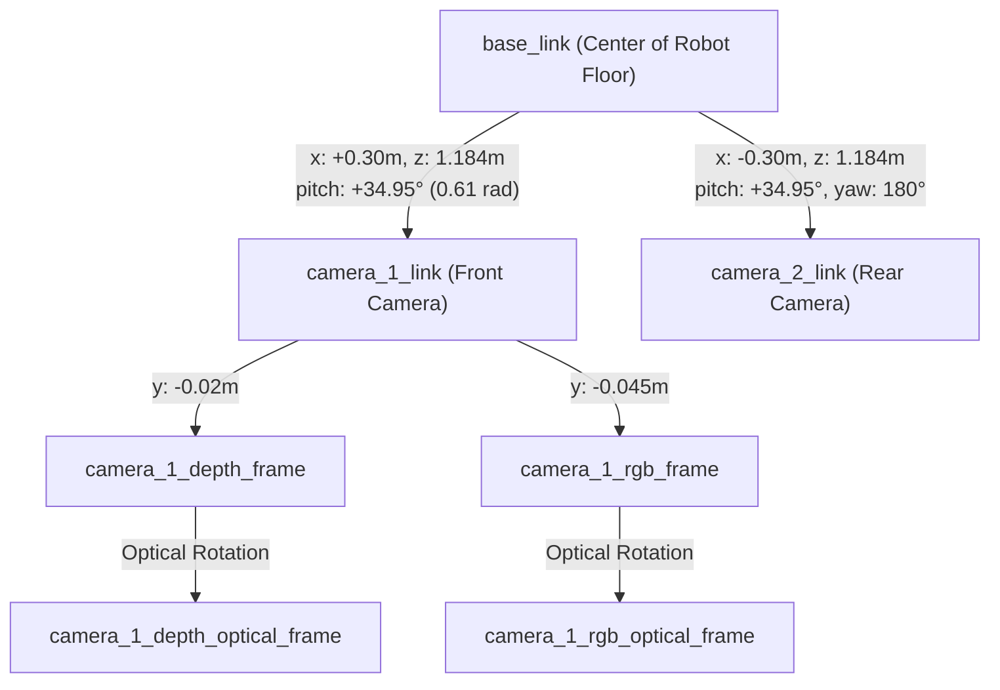
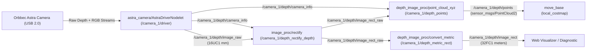

# Keenon T2 Depth Camera Subsystem Analysis & Navigation/Mapping Audit

**Target Robot:** `peanut@192.168.64.20` (Keenon T2 Delivery Robot)  
**Date of Audit:** November 2026  
**Software Environment:** ROS Indigo / Ubuntu 14.04 Trusty (Linux 4.4.0-31-generic x86_64)

---

## 1. Executive Summary

This document presents a comprehensive technical analysis of the depth camera hardware, software drivers, calibration, and behavioral integration in the Keenon T2 robot framework. 

### Core Audit Finding: Mapping vs. Task Navigation
> [!IMPORTANT]
> **The depth camera is NOT used in the mapping process (SLAM). It is strictly used during autonomous task execution and navigation.**
> 
> * **During Mapping (SLAM):** Neither Cartographer nor Gmapping consumes depth camera point clouds. The Cartographer SLAM configuration (`keenon_T2.lua`) is explicitly configured with `num_point_clouds = 0` and relies solely on the front and rear 2D LiDARs (`num_laser_scans = 2`). The OpenT2 mapping launch file (`mapping.launch`) does not even launch the depth camera driver.
> * **During Task Navigation:** The depth camera point cloud (`/camera_1/depth/points`) is subscribed exclusively by `move_base` for the **local costmap obstacle layer** (`costmap_2d::ObstacleLayer`). It provides real-time 3D collision avoidance for objects that the low-mounted planar LiDARs cannot detect (e.g., table tops, chairs, desks, overhanging countertops).

---

## 2. Hardware Identification & Specifications

| Component / Parameter | Specification | Verification Method |
| :--- | :--- | :--- |
| **Manufacturer** | **Orbbec 3D** | `lsusb` (Vendor ID: `2bc5`) |
| **Model** | **Astra** | `lsusb` (Product ID: `0407`) |
| **Technology** | Structured-light Infrared (IR) Projector + CMOS Sensor + RGB Sensor | Hardware-level depth registration to RGB frame |
| **Active Front Serial** | `20122220038` | `rosservice call /camera_1/get_serial` |
| **Design Architecture** | Dual-depth camera system (`camera_1` front, `camera_2` rear) | ROS nodes & URDF joint kinematic definitions |
| **Current Live Status** | **Front Camera (`camera_1`):** Online & publishing @ ~9.87 Hz<br>**Rear Camera (`camera_2`):** Offline / USB unplugged | `lsusb -t` & `/camera_1/depth/points` hz |
| **Raw Depth Mode** | Mode 8 (QVGA $320 \times 240$ @ 30 Hz) | Driver parameter `depth_mode: 8` |
| **Throttled Publishing Rate**| **~10 Hz** (measured `9.87 Hz`) | Configured via `data_skip: 2` (skips 2 out of 3 frames) |
| **Color Stream Mode** | Mode 5 (VGA $640 \times 480$ @ 30 Hz) | Driver parameter `color_mode: 5` |
| **Effective Detection Range**| 0.6 m – ~4.0 m (Hardware limit)<br>**0.333 m – 1.20 m** (Costmap active window) | Gated in `local_costmap_params.yaml` |

---

## 3. Physical Mounting & Kinematic Transform (TF Tree)

The physical mounting coordinates are defined in the robot's URDF (`/robot_description`) and static transform publishers (`astra_frames.launch`).

### A. Kinematic Coordinates relative to `base_link`



1. **Front Camera (`camera_1_link`)**:
   - **Translation**: $[x = +0.300\text{ m}, y = 0.000\text{ m}, z = 1.184\text{ m}]$
   - **Rotation (RPY)**: $[0.0, +0.610\text{ rad}, 0.0] \approx [0.0^\circ, +34.95^\circ, 0.0^\circ]$
   - **Orientation**: Mounted high on the front column tilted **downward by ~35°** towards the ground ahead.
2. **Rear Camera (`camera_2_link`)**:
   - **Translation**: $[x = -0.300\text{ m}, y = 0.000\text{ m}, z = 1.184\text{ m}]$
   - **Rotation (RPY)**: $[0.0, +0.610\text{ rad}, 3.142\text{ rad}] \approx [0.0^\circ, +34.95^\circ, 180.0^\circ]$
   - **Orientation**: Mounted high on the rear column tilted **downward by ~35°** towards the ground behind.
3. **Optical Offsets (`astra_frames.launch`)**:
   - Depth optical offset: $y = -0.020\text{ m}$ relative to camera body.
   - RGB optical offset: $y = -0.045\text{ m}$ (2.5 cm baseline between optical centers).
   - Optical rotation applied: Yaw $-90^\circ$, Pitch $-90^\circ$ to convert ROS coordinate convention ($X$-forward, $Y$-left, $Z$-up) to standard optical frame ($Z$-depth forward, $X$-right, $Y$-down).

---

## 4. Software Driver & Nodelet Processing Pipeline

The Orbbec Astra cameras are managed via ROS nodelets running inside `/camera_1/camera_1_nodelet_manager` (configured with 2 worker threads).



### Active Topics & Message Types
- `/camera_1/depth/points` (`sensor_msgs/PointCloud2`): Dense 3D point cloud unprojected into `camera_1_rgb_optical_frame`. Publishing at **~9.87 Hz** with ~6,000 valid points per frame.
- `/camera_1/depth/image_raw` (`sensor_msgs/Image`): Raw depth image in `16UC1` format (depth in millimeters).
- `/camera_1/depth/camera_info` (`sensor_msgs/CameraInfo`): Intrinsics:
  - Width: 320, Height: 240
  - Focal length: $f_x = 285.17\text{ px}, f_y = 285.17\text{ px}$
  - Optical center: $c_x = 159.50\text{ px}, c_y = 119.50\text{ px}$
  - Distortion: Plumb Bob $[0, 0, 0, 0, 0]$ (pre-rectified in hardware)
  - Calculated FOV: Horizontal $\approx 58.6^\circ$, Vertical $\approx 45.6^\circ$.

---

## 5. Mapping vs. Task Navigation Analysis

### Question: Is the depth camera used in the mapping process or only while the robot is on a task?

### Conclusion: **It is ONLY used during task navigation.**

Here is the step-by-step evidence across the codebase and runtime architecture:

### 1. Cartographer SLAM Configuration Proof
In `/opt/ros/indigo/share/cartographer_ros/configuration_files/keenon_T2.lua` and `/home/peanut/open_t2_ws/src/open_t2_mapping/config/keenon_T2.lua`:
```lua
options = {
  ...
  num_laser_scans = 2,
  num_multi_echo_laser_scans = 0,
  num_subdivisions_per_laser_scan = 1,
  num_point_clouds = 0,               -- <--- POINT CLOUDS EXPLICITLY DISABLED
  ...
}

MAP_BUILDER.use_trajectory_builder_2d = true
TRAJECTORY_BUILDER_2D.num_accumulated_range_data = 2
```
* `num_point_clouds = 0`: Cartographer is configured to reject any 3D point clouds.
* `num_laser_scans = 2`: Cartographer accepts only the two planar LiDAR scan streams (`scan_front_orig` and `scan_back_orig`).

### 2. Gmapping SLAM Configuration Proof
In `/opt/ros/indigo/share/robot_settings/cfg/yaml/T2/gmapping_online_params.yaml`:
* Gmapping is configured as a standard 2D laser SLAM node.
* It subscribes strictly to `/scan` (single 2D `sensor_msgs/LaserScan`). It has no point cloud input interface.

### 3. OpenT2 Mapping Launch Proof
In `/home/juza/slam_t2/OpenT2/mapping/launch/mapping.launch`:
* Sensors launched for mapping:
  1. `chassis.launch` (wheel odometry)
  2. `robot_state_publisher.launch` (URDF model & static TFs)
  3. `keli_2.launch` (Front & Rear SDKELI 2D LiDARs)
  4. `multi_lidar_filter` & `multi_lidar_filter_for_planner`
  5. `robot_location.launch` (front-end odometry TF)
  6. `cartographer_node` & `cartographer_occupancy_grid_node`
* **`astra_2.launch` (depth camera driver) is not launched at all.**

### 4. Navigation Launch Proof
In `/home/juza/slam_t2/OpenT2/mapping/launch/navigation.launch`:
```xml
  <!-- 2. Start SDKELI LiDAR Sensors and Depth Cameras -->
  <include file="$(find robot_settings)/launch/include/keli_2.launch">
    <arg name="ROBOT_TYPE" value="$(arg robot_type)"/>
  </include>
  <include file="$(find robot_settings)/launch/include/astra_2.launch">
    <arg name="ROBOT_TYPE" value="$(arg robot_type)"/>
  </include>
```
* The depth cameras are explicitly launched in `navigation.launch` to provide point cloud feeds for `move_base`.

### 5. Runtime Topic Subscription Verification
Running `rostopic info /camera_1/depth/points` on the live robot reveals:
```
Type: sensor_msgs/PointCloud2

Publishers: 
 * /camera_1/camera_1_nodelet_manager

Subscribers: 
 * /move_base
```
* **Only `/move_base` subscribes to the depth camera point cloud.**
* No mapping, SLAM, or localization node subscribes to this topic.

---

## 6. How the Depth Camera is Applied in Navigation & Tasks

### Why Depth Cameras are Necessary
The Keenon T2 is equipped with two 2D LiDARs mounted at $z = 0.225\text{ m}$ (22.5 cm above the floor). This leaves an enormous perceptual blind spot between $0.3\text{ m}$ and $1.5\text{ m}$:
- Dining table tops (typical height: $0.72\text{ m} - 0.76\text{ m}$)
- Overhanging desk cantilevers
- Serving trays, bar counters, and chair seats
- Human torsos

Without depth cameras, a robot relying only on low 2D LiDAR would attempt to navigate under table tops, thinking the space is completely clear because the table legs are the only obstacles visible to the LiDAR.

### Costmap Integration (`costmap_2d::ObstacleLayer`)
In `/opt/ros/indigo/share/robot_settings/cfg/yaml/T2/local_costmap_params.yaml`:
```yaml
local_costmap:
  global_frame: odom
  robot_base_frame: base_link
  update_frequency: 20.0
  publish_frequency: 5.0
  rolling_window: true
  width: 4.0
  height: 4.0
  resolution: 0.03
  plugins: 
    - {name: virtual_wall, type: "costmap_2d::StaticLayer"}
    - {name: obstacle_layer, type: "costmap_2d::ObstacleLayer"}
    - {name: inflation_layer, type: "costmap_2d::InflationLayer"}

  obstacle_layer:
    observation_sources: scan camera_1 camera_2 bump gate foot mx_camera_L mx_camera_R
```

In `costmap_common_params.yaml`:
```yaml
camera_1: {
  sensor_frame: camera_1_link,
  topic: /camera_1/depth/points,
  data_type: PointCloud2,
  expected_update_rate: 1.0,
  observation_persistence: 0.0,
  obstacle_range: 1.2,
  min_obstacle_height: 0.333,
  max_obstacle_height: 1.5,
  marking_allow_timeout: true
}
```

### Height Gating & Ground Rejection Mechanism
Because the camera is mounted at $1.184\text{ m}$ and angled $35^\circ$ downward, a wide field of view strikes the floor within $1.5\text{ m}$ in front of the robot.
- **`min_obstacle_height: 0.333`**: The costmap obstacle layer transforms all 3D points from `camera_1_rgb_optical_frame` into `base_link` coordinates. Any points with $Z_{base\_link} < 0.333\text{ m}$ (33.3 cm) are **discarded**. This prevents the floor from being marked as an obstacle.
- **`max_obstacle_height: 1.500`**: Discards ceiling lights and tall overhead structures.
- **`obstacle_range: 1.2`**: Discards points farther than 1.2 meters to focus computational resources on immediate collision hazards.
- **Lethal Cost Marking (`254`)**: Surviving points are projected down to 2D grid cells and marked as lethal obstacles.
- **TEB Local Planner Reaction**: The planner generates a collision-free velocity trajectory (`cmd_vel`) dynamically avoiding the obstacle.

---

## 7. Comparison with Other Robot Vision Subsystems

| Vision Sensor | Hardware Link | Extrinsics | Primary Task |
| :--- | :--- | :--- | :--- |
| **Depth Camera 1 (Front)** | `camera_1_link` | $x=+0.30\text{m}, z=1.184\text{m}$, Pitch $=+35^\circ$ | Local 3D obstacle avoidance (tables, chairs) during navigation |
| **Depth Camera 2 (Rear)** | `camera_2_link` | $x=-0.30\text{m}, z=1.184\text{m}$, Pitch $=+35^\circ$, Yaw $=180^\circ$ | Rear 3D obstacle avoidance during reversal |
| **Ceiling Label Camera** | `label_camera_link` | $x=0.00\text{m}, z=1.200\text{m}$, Pitch $=180^\circ$ (upward) | Relocalization via ceiling QR/AprilTag landmark markers (`ros_label_fusion`) |
| **2D LiDARs (Front/Back)** | `laser_front_link`, `laser_back_link` | $x=\pm 0.193\text{m}, z=0.225\text{m}$ (horizontal) | 2D SLAM Mapping, long-range global localization, and primary 2D path planning |
| **MX Camera (`/mx/cloud1`)** | `mx_camera_link` | $x=0.31\text{m}, y=0.06\text{m}, z=0.19\text{m}$ | Legacy TOF obstacle detection (disabled, `USE_SUSPEND: false`) |

---

## 8. Current System Diagnostics & Recommendations

### Diagnostic Observations
1. **Front Camera (`camera_1`)**: Fully operational. Continuously publishing 3D points at ~10 Hz into `/move_base`.
2. **Rear Camera (`camera_2`)**: 
   - `camera_2_nodelet_manager` is running in ROS, but no USB device is enumerated for it (`lsusb` lists only one Orbbec Astra device `2bc5:0407` on bus `1-4`).
   - System logs (`syslog.1`) prove that the second camera was previously active on USB port `1-3`.

### Practical Recommendations
1. **If Running Navigation with Rear Camera Unplugged**:
   - `move_base` may throw a sensor stale timeout warning:
     ```
     [WARN] [/move_base]: Sensor data is out of date, we're not going to allow commanding of the base for safety
     ```
   - If this occurs, edit `local_costmap_params.yaml` to temporarily remove `camera_2` from `observation_sources`:
     ```yaml
     obstacle_layer:
       observation_sources: scan camera_1 bump
     ```
2. **To Restore the Rear Depth Camera**:
   - Reseat the rear camera USB cable internally on the robot's mainboard/hub.
   - Run the factory pairing script:
     ```bash
     sudo bash /opt/ros/indigo/share/robot_settings/system/bin/dual_camera_setup.bash
     ```
   - Verify both cameras with:
     ```bash
     /opt/ros/indigo/lib/astra_camera/astra_list_devices
     ```
